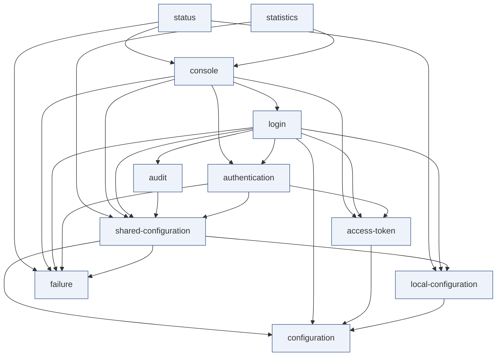
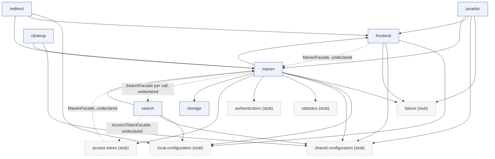
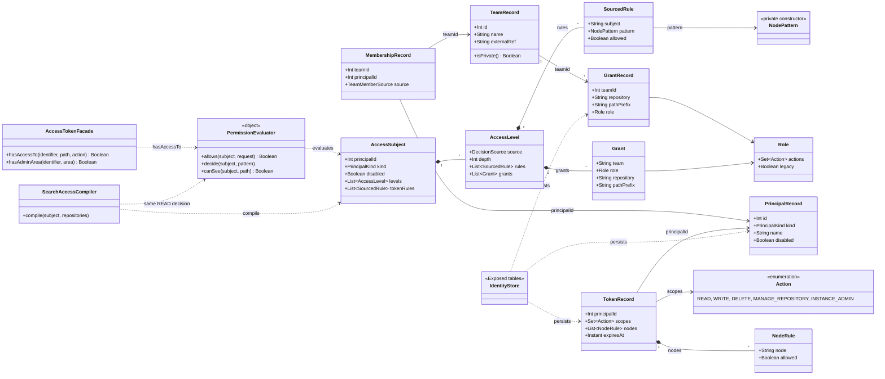
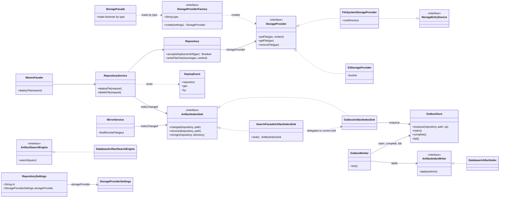
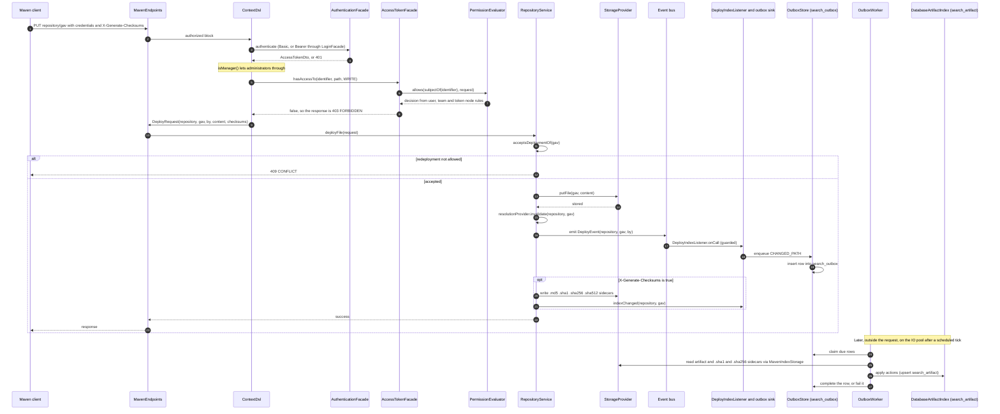

# Backend architecture

Ingot is a fork of Reposilite. The backend is a set of plugins that register routes, facades and event listeners into one runtime. Most of the code is organised by domain (maven, identity, search, token and so on), and each domain package follows the same internal layout. This page explains that structure. It describes the code as it is on `main`, not as it was planned, and it names the packages and classes the code actually uses.

The page has two complementary views of the same backend. The layer view answers which packages may depend on which. The UML views answer which concrete types exist, how they relate, and what happens at runtime. The last section explains how the two views differ and where the code does not follow the layer rules.

## Packages and naming

The backend has two source trees, which are kept apart on purpose.

- `reposilite-backend/src/main/kotlin/com/reposilite/` holds the original Reposilite code and all plugin-facing packages.
- `reposilite-backend/src/main/kotlin/net/onelitefeather/ingot/` holds the code Ingot adds: identity, login, search and related parts.

The Java and Kotlin package names under `com.reposilite.*` stay, so existing Reposilite plugins still compile against Ingot. New Ingot code goes under `net.onelitefeather.ingot.*`. The namespace rule is covered in [the last section](#namespace-split).

Within a domain package the convention is:

| Subpackage | Holds |
| --- | --- |
| `api/` | Public DTOs, events and plugin-facing types |
| `application/` | The plugin class (`*Plugin`), component wiring, `*Settings` classes |
| `infrastructure/` | Javalin endpoints and SQL repositories (Exposed) |
| package root | Domain services and facades (for example `MavenFacade`, `RepositoryService`) |

Some domains deviate from this layout. `identity/` splits into `api`, `evaluation`, `login`, `model`, `service`, `session` and `storage`, and `search/` splits into `access`, `api`, `application`, `database`, `outbox`, `rebuild`, `runs` and `verify`. The layer view below uses the real packages.

## Layer view

The layer view shows the intended dependency direction: transport calls application, application calls domain and infrastructure, and infrastructure implements the ports that the domain defines. The dashed side lane holds the concerns that touch every layer. The thick red arrow marks where application code reaches infrastructure directly, which is one of the deviations discussed below.

```mermaid
flowchart TB
  subgraph WEB["Transport and web"]
    W1["web/infrastructure: HttpServer, JavalinConfiguration, ReposiliteRouting"]
    W2["Endpoints: maven/infrastructure, identity/api, token/infrastructure, search/api, javadocs/infrastructure"]
    W3["console/infrastructure: REST, SSE live log, WebSocket"]
    W4["frontend/infrastructure: FrontendHandler, NotFoundHandler"]
  end
  subgraph APP["Application"]
    A1["Plugins: application/ *Plugin classes, 19 in total"]
    A2["Facades: MavenFacade, IdentityFacade, SearchFacade, AccessTokenFacade, LoginFacade"]
    A3["Services: RepositoryService, MirrorService, SessionService, RebuildService, VerifyService"]
    A4["Settings: *Settings classes bound through @Plugin(settings)"]
  end
  subgraph DOM["Domain"]
    D1["identity/model and identity/evaluation: PermissionEvaluator"]
    D2["maven: Repository, Location, Checksum, DeployRequest"]
    D3["search: ArtifactPathParser, IndexModel, ArtifactIndexSink, ArtifactSearchEngine"]
  end
  subgraph INF["Infrastructure"]
    I1["Exposed SQL: *Table objects, Sql* repositories, IdentityStore, LoginStore, OutboxStore"]
    I2["Storage: storage/filesystem and storage/s3 (StorageProvider, StorageEntrySource)"]
    I3["HTTP clients: shared/http (RemoteClient), identity/login/oidc/OidcHttp, identity/login/ldap"]
  end
  subgraph XC["Cross-cutting concerns"]
    X1["Authentication: Authenticator, LoginFacade, sessions in identity/session"]
    X2["Authorization: ContextDsl.authorized, AccessTokenFacade.hasAccessTo, PermissionEvaluator"]
    X3["Events: plugin/Extensions (emitEvent, sorted listeners), DeployEvent, DeleteEvent, RoutingSetupEvent"]
    X4["Logging: Journalist (external library, com.reposilite.journalist)"]
    X5["Configuration: configuration/local (configuration.cdn, env overrides), configuration/shared (SettingsTable)"]
  end
  WEB --> APP
  APP --> DOM
  APP -.->|"via ports"| INF
  APP ==>|"direct imports (deviation)"| INF
  INF -.->|"implements ports"| DOM
  XC -.- APP
  XC -.- WEB
  XC -.- INF
  classDef cross fill:#f4f4f4,stroke:#777,stroke-dasharray: 4 3
  class X1,X2,X3,X4,X5 cross
```

What each layer contains:

- **Transport and web.** Javalin starts in `web/infrastructure`. Each domain registers its routes as `ReposiliteRoute` objects, typically from a `RoutingSetupEvent` listener. The console is served over REST, SSE and WebSocket, and the bundled dashboard is served by `frontend/infrastructure`.
- **Application.** The 19 plugins wire the domain together. A plugin builds its components, publishes a facade, and subscribes to events. Application code also owns the settings classes, which the configuration system reads.
- **Domain.** Models, the permission evaluator, the artifact path parser and the index model. These types have no Javalin or Exposed dependency in their intended form. The deviations section lists where that rule is broken.
- **Infrastructure.** Exposed tables and repositories, the storage providers (filesystem and S3), HTTP clients for mirrors and OIDC, and LDAP.
- **Cross-cutting.** Authentication and authorization, the event bus, logging, and configuration cut across the layers rather than sitting in one of them.

## Plugin system

A plugin is a class annotated with `@Plugin` that implements `ReposilitePlugin`. The annotation carries the plugin's name, its declared `dependencies` (other plugin names) and optionally a `settings` class.

The lifecycle runs in four steps, as set up by `ReposiliteFactory` and `PluginLoader`:

1. **Discovery.** Built-in plugins are listed in `META-INF/services/com.reposilite.plugin.api.ReposilitePlugin`. Jars in the plugins directory are loaded with a `URLClassLoader` and `ServiceLoader`. The `Reposilite` instance is registered as a facade before any plugin initialises.
2. **Load.** Every plugin's `load()` runs. No plugin in the repository overrides it.
3. **Ordering.** Plugins are sorted by name, then topologically by their declared `dependencies`. An unknown dependency or a cycle stops startup.
4. **Initialise.** Each plugin's `initialize()` runs in that order and returns a facade, which is registered for lookup.

Plugins talk to each other in two ways:

- **Facades.** `facade<F>()` looks up the first registered facade that is an instance of `F`, and throws if none is registered. A facade is a plugin's public surface, such as `MavenFacade`, `IdentityFacade` or `SearchFacade`.
- **Events.** `event<E>(listener)` subscribes to an event type. Events are emitted through `Extensions.emitEvent`, which calls the listeners synchronously, sorted by priority.

The declared `dependencies` decide startup order, but the code does not check them against the `facade<F>()` calls. A plugin that looks up a facade eagerly in `initialize()` must declare that dependency, or startup fails. A lookup inside a route or event lambda runs later, after every plugin has initialised, so it works without a declaration. Several plugins rely on that, as the component views and deviations section show.

## UML component view

The 19 plugins are split into two diagrams to keep each one readable. Arrows point from the consumer to the plugin it uses. Solid arrows are declared `dependencies` in the `@Plugin` annotation. Dotted arrows are facade lookups that are not declared.

The first diagram holds the foundation and identity plugins. Its dependencies are all internal to the group.

The second diagram holds the content and delivery plugins. The foundation plugins they depend on appear as stubs. The dotted arrows are the undeclared lookups.

The `web` plugin has no declared dependencies and no dependents. It only holds `WebSettings` and makes the Javalin configuration available, so it is left out of both diagrams.

Three of the undeclared lookups are deliberate, or at least documented in the code:

- `FrontendPlugin` resolves `MavenFacade` inside a route lambda. Its comment says this avoids a cycle, because `MavenPlugin` depends on the frontend.
- `AccessTokenPlugin` resolves `MavenFacade` inside lazy lambdas that run per request.
- `SearchPlugin` resolves `AccessTokenFacade` inside the `RoutingSetupEvent` listener.

The fourth, `maven -.-> search`, is a runtime link that no declaration covers. Maven hands artifact changes to an `ArtifactIndexSink`. The sink it receives is `SearchFacadeArtifactIndexSink`, which looks up `SearchFacade` on every call and falls back to a no-op sink when search is absent or disabled.

## UML class view: identity and permissions

This diagram shows the core types of the identity model and how a permission decision is made. The brief named a `Principal` type. The code uses `PrincipalRecord` (in `identity/model/IdentityModel.kt`), and there is no class called `Principal`. The record holds an identity of kind user or machine, and the access subject built from it is `AccessSubject`.

How a decision is made:

- `PermissionEvaluator` is a stateless `object`. It takes an `AccessSubject`, which already contains the subject's levels (user, team, inherited team, legacy, token) and its token node rules, and returns a decision. It does not read the database.
- `AccessTokenFacade` builds the `AccessSubject` for a token and calls the evaluator. This is the path that `ContextDsl.authorized` uses for every route.
- Routes check the HTTP method through `METHOD_ACTIONS`, which maps HEAD and GET to `READ`, PUT and POST to `WRITE`, and DELETE to `DELETE`. `PATCH` and `OPTIONS` are not in the map. Any future `authorized {}` route on those methods would hit the `!!` in `ContextDsl`. The existing PATCH route in `AccessTokenApiEndpoints` uses `managerOnly`, so nothing breaks today.
- `SearchAccessCompiler` decides the same question as `PermissionEvaluator.allows` for `READ`, but for a whole set of repositories at once. It returns an access description that `SearchAccessSql` turns into a SQL filter, so that search results are limited to what the caller can read.

## UML class view: maven, storage and search

This diagram follows an artifact from the Maven repository service into the storage providers and into the search index. Storage selection works through a string `type` on each repository's settings, not through an enum.

Notes on this model:

- `StorageProviderFactory` is generic over its provider and settings types. The two factories are `FileSystemStorageProviderFactory` (type `fs`) and `S3StorageProviderFactory` (type `s3`), registered through `ServiceLoader`. `RepositoryFactory` throws when a repository names a type that no factory provides.
- `FileSystemStorageProvider` is abstract and delegates `StorageEntrySource` to a `FileSystemEntrySource`. The S3 side has a separate `S3EntrySource`.
- Checksums are not a storage concern. `Repository.writeFileChecksums` writes the `.md5`, `.sha1`, `.sha256` and `.sha512` sidecar files through the storage provider, and it runs only when the request sends `X-Generate-Checksums: true`.
- The index is reached through the `ArtifactIndexSink` interface. Maven never imports the search database, outbox or API packages. The only search type Maven code refers to is the sink interface and the wiring of `SearchFacadeArtifactIndexSink`.
- `DatabaseArtifactIndex` is the write side of the search index and implements `ArtifactIndexWriter`, which lives in the outbox package. `DatabaseArtifactSearchEngine` is the read side.

## Sequence: a Maven deploy

The sequence follows one `PUT` request from authentication to the search index. The indexing steps happen after the request returns, in a worker, so they are shown as a separate part.

Reading the sequence:

- Authentication and authorization happen before any storage write. A token without write access to the path never reaches `RepositoryService`.
- The file is stored before `DeployEvent` is emitted. Listeners therefore see a file that exists, and a listener that throws after the write leaves the file stored.
- `DeployEvent` also reaches `PreservedBuildsListener`, `AuditPlugin` and `JavadocPlugin`. Only the search listeners wrap their call in `guarded`. The event bus does not isolate listeners, so the other listeners can fail the request after the write.
- With checksums requested, the same path is queued twice. The worker collapses duplicate rows, so the second queue entry is harmless.
- Search is eventually consistent. A deploy returns before the index row exists, and the worker fills in the index on its next tick.

## Layer view vs UML

The two views answer different questions and are meant to be read together.

The **layer view** answers which packages may depend on which. It shows direction and allowed edges: transport calls application, application calls the domain, infrastructure implements domain ports. It hides concrete types and does not show runtime calls. Its purpose is to say where a change should go and where a dependency is a mistake. A layer diagram with a violation shows the violation as an arrow in the wrong direction, which is what the thick arrow in the first diagram does.

The **UML views** answer which concrete types exist, how they relate, and what happens at runtime. The component view covers plugins and facade lookups, the class view covers types and their associations, and the sequence view covers one flow in time. They show what the code is, not what it should be.

Using both is useful because they disagree in informative places. A plugin that looks up another plugin's facade appears in the component view as a dependency, but the layer view says nothing about plugins. A class that imports a Javalin type appears in the class view as a dependency on a framework type, which is the layer violation the layer view should be showing.

### Where the code deviates from strict layering

These deviations were found by reading imports and facade lookups in the code. Each one is a fact about the current code, not a judgement about whether it should change.

1. **Facades looked up across plugins without a declared dependency.** `FrontendPlugin` resolves `MavenFacade` (`FrontendPlugin.kt`, route lambda). `AccessTokenPlugin` resolves `MavenFacade` in lazy lambdas (`AccessTokenPlugin.kt`). `SearchPlugin` resolves `AccessTokenFacade` in the routing listener (`SearchPlugin.kt`). The declared `dependencies` are not checked against these calls.
2. **Maven reaches search at runtime with no declared link.** `SearchFacadeArtifactIndexSink` finds `SearchFacade` per call. Maven code calls `ArtifactIndexSink` directly in five places (`RepositoryService.kt`, `MirrorService.kt`, `MetadataService.kt`, `PreservedBuildsListener.kt`, `MavenFacade.kt`) instead of only publishing events.
3. **Application code imports infrastructure.** `RedirectPlugin` and `FrontendPlugin` import `maven.infrastructure.MavenEndpoints`, and `RedirectPlugin` constructs it. `CleanupPlugin` imports `scheduling.infrastructure.SqlScheduledJobClaims`. `SearchPlugin` imports `maven.infrastructure.SqlMirrorCacheLedger` and `scheduling.infrastructure.SqlScheduledJobClaims`, and takes an Exposed `Database` directly. The `*Components` files in `audit`, `configuration`, `statistics` and `token` take an Exposed `Database` as well.
4. **Cross-domain types in a plugin.** `AccessTokenPlugin` imports `identity.service.IdentityFacade` and `identity.storage.IdentityStore`. The token domain depends on identity internals, which the plugin graph does not declare.
5. **HTTP types in the service and shared layers.** `identity/service/IdentityFacade.kt` imports `io.javalin.http.HttpStatus` constants (`CONFLICT`, `FORBIDDEN`, `PRECONDITION_FAILED`). `shared/ContextDsl.kt` imports Javalin and `identity.model.Action`. The service layer therefore knows about the web layer.
6. **Event listeners without isolation.** `Extensions.emitEvent` calls listeners in sequence with no exception handling. Only `DeployIndexListener` and `DeleteIndexListener` wrap their calls in `guarded`.
7. **Settings classes import Javalin annotations.** Settings in `application/` carry `io.javalin.openapi.JsonSchema` annotations. This is a compile-time annotation for documentation, not a runtime dependency on the web layer.

Not a deviation: `identity/storage` and `identity/login/storage` use Exposed directly. Those packages are the infrastructure for identity, so the Exposed dependency is expected there.

### Namespace split

The namespace is split on purpose, and the split is part of the plugin contract.

- The Maven group is `net.onelitefeather.ingot`.
- Java and Kotlin packages stay `com.reposilite.*`, so plugins written for Reposilite compile against Ingot unchanged.
- Module directories and library artifact IDs stay `reposilite-*`.
- New Ingot code goes in `net.onelitefeather.ingot.*`, which is why the identity and search code sits in that tree.
- `com.reposilite.journalist` is a third-party library and must not be moved with the rest.

A blanket package move would break plugins, so changes that touch packages should move only the code that is actually rewritten.

## Verification notes

What was checked against the code: the 19 `@Plugin` declarations and their dependency lists, the facade and event mechanisms, the storage factories and their type strings, the Exposed dialect dispatch, the deploy path from endpoint to event listener, the outbox enqueue and worker, the permission check chain, and the import-level deviations listed above.

What was not verified: the internals of the `Journalist` library (it is external), the full behaviour of `LoginStore` and `CustomFrontendHandler`, the mirror cache's eviction rules, and the runtime effect of the listener-isolation gap, which was read from the code but not reproduced.
