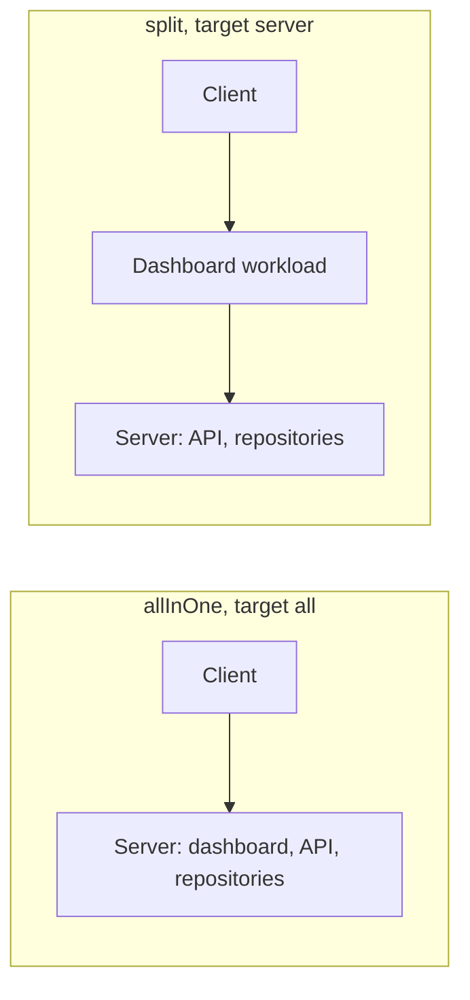

# Deployment modes

An Ingot server can serve everything from one process, or serve only the API and the repositories while the dashboard runs in a second workload. This page explains the two settings that choose between them, the deploy target of the server and the mode of the Helm chart, and how they fit together. Pick a mode here, then follow the link to the how-to page.

## The deploy target

The deploy target names what one server process serves. It is set with `--target`, the system property `ingot.target` or the environment variable `INGOT_TARGET`. The full rules are in [Deploy targets](../configuration/deploy-targets.md).

| Target | Serves | Does not serve |
|:--|:--|:--|
| `all` | The dashboard, the API and the repositories. This is the default. | Nothing. |
| `server` | The API and the repositories. | The dashboard routes. |

An instance that sets no target runs as `all`, so an existing Reposilite deployment behaves as before. The older switch `defaultFrontend: false` still works and means `server` when no target is set.

## The Helm chart mode

The Helm chart has a value `mode` that chooses the shape of the release. See the [Helm chart values](../configuration/helm-values.md) reference for every key.

| Mode | Workloads | Target of the server |
|:--|:--|:--|
| `allInOne` | One Deployment that serves the dashboard and the API. This is the default. | `all` |
| `split` | The server, and a dashboard Deployment from the dashboard image in front of it. | `server` (the chart sets `INGOT_TARGET=server`) |

The diagram puts the two modes side by side. The split changes which process serves which path. It does not change the data.

## Running more than one replica

The mode and the number of replicas are separate choices. Several server replicas share one database and one object storage, and the optional cluster bus speeds up the spread of revocations and cache invalidations. The page [Multi-replica operation](multi-replica-operation.md) explains the mechanics, and [High availability support](high-availability-support.md) states what is supported.

## Choosing a mode

* Use `allInOne`, or a plain JAR or container, when the dashboard and the API can share one process.
* Use `split` when the dashboard should restart, scale or be hardened apart from the artifact store.

[Deployment options compared](../../set-up/deployment-options-compared.md) compares how each shape is installed, upgraded and rolled back.

## Related pages

* [Deploy targets](../configuration/deploy-targets.md)
* [Run the dashboard in a separate container](../../set-up/deploy/run-split-dashboard-container.md)
* [Run the dashboard split from the server with Helm](../../set-up/kubernetes/run-split-with-helm.md)
* [Run on Kubernetes](../../set-up/kubernetes/run-on-kubernetes.md)
* [Architecture overview](architecture-overview.md)
