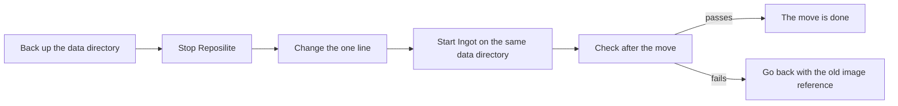

# Move from Reposilite to Ingot

Moving from Reposilite to Ingot changes one line: the image reference in a deployment, the name of the JAR you start, or the dependency coordinate in a build. The data directory, the configuration, the environment variables, the port and the plugins stay as they are. This page lists the one line for each way of running Ingot, and what to check afterwards.

This page covers Reposilite 3.x. Ingot is based on Reposilite 3.5.28. The container upgrade tests cover 3.5.28 on SQLite and on MariaDB 11.4. Reposilite 3.6.x is not covered by these tests, see [Reposilite 3.6.x settings](#reposilite-36x-settings). For the full list of what stays the same, read [Drop-in compatibility with Reposilite](../../introduction/drop-in-compatibility.md).

The diagram shows the order of the move. The data directory stays where it is, and a rollback uses the backup and the old image reference.



## Before you begin

* A [backup](../../manage/upgrade/upgrade-ingot.md#back-up-before-upgrading) of the data directory and, for MariaDB, of the database. The first start of Ingot migrates the data, and a rollback to Reposilite does not take that migration back.
* The image `ghcr.io/onelitefeathernet/ingot:1.2.0`. Earlier Ingot releases do not run this migration.
* The Reposilite release you run now. Keep its image reference or JAR name, because you need it for a rollback.
* Reposilite 3.x. For a Reposilite 2.x installation, follow [Upgrade from Reposilite 2.x](../../manage/upgrade/upgrade-from-reposilite-2.md) instead, because it needs its own steps.

## Change the one line

### Container image with Docker Compose

Stop the server, then replace the image reference of the service. Leave the rest of the file as it is. Start the server again on the same data directory. The existing data is adopted.

```yaml
services:
  reposilite:
    # image: dzikoysk/reposilite:<your-reposilite-tag>
    image: ghcr.io/onelitefeathernet/ingot:1.2.0
```

Use the full version of the release in production, as described in [Install with Docker](../deploy/install-with-docker.md#choose-an-image-tag).

### Container image on Kubernetes

For a Deployment or StatefulSet that you write yourself, change the `image` of the container, and keep the volume, the probes and the environment:

```yaml
containers:
  - name: ingot
    image: ghcr.io/onelitefeathernet/ingot:1.2.0
```

If you deploy with the Ingot Helm chart, the image is set by `image.name` and `image.tag` (or `image.digest`) in the values. The steps are in [Run on Kubernetes](../kubernetes/run-on-kubernetes.md).

### JAR

Start the Ingot JAR where you started the Reposilite JAR, in the same working directory. The JAR of a release is named `ingot-<version>.jar`.

```bash
java -jar ingot-<version>.jar
```

Ingot uses the current directory as its working directory unless you pass `--working-directory` or `-wd`, so keep the start in the directory that holds the data. The JAR page is [Run the JAR](../deploy/install-jar.md).

### Dependency coordinate in a build

If your build depends on the server bundle, or compiles a plugin against it, change the coordinate. The packages in the code stay `com.reposilite.*`, so the code does not change.

Gradle, Kotlin DSL:

```kotlin
// compileOnly("com.reposilite:reposilite:<reposilite-version>")
compileOnly("net.onelitefeather.ingot:ingot:<ingot-version>")
```

Maven:

```xml
<dependency>
  <groupId>net.onelitefeather.ingot</groupId>
  <artifactId>ingot</artifactId>
  <version><ingot-version></version>
</dependency>
```

The build of this repository gives the server bundle the coordinate `net.onelitefeather.ingot:ingot`. It does not configure a publishing target in its build script, so check the release notes of the version you use for where it is available. [Write a plugin](../../manage/plugins/write-a-plugin.md) shows the plugin build in full.

## What stays the same

* The image keeps the entrypoint, the paths `/app/data` and `/var/log/reposilite`, the port `8080`, the volume and the health check.
* The environment variables you set keep working. `REPOSILITE_` names are read as fallbacks. A variable with the `INGOT_` name takes precedence when both are set, so you can rename them one at a time.
* The data directory is adopted as it is. The file names `configuration.cdn`, `configuration.shared.json` and `reposilite.db` do not change.
* The plugins keep working. Their packages are `com.reposilite.*`, and their JARs go into the same `plugins` directory.
* Build tools keep their setup. The repository URLs, the tokens and the basic authentication stay as they are, and the paths of artifacts do not change.

What changes is listed in [Drop-in compatibility with Reposilite](../../introduction/drop-in-compatibility.md#what-changes-under-the-hood). It includes the way tokens belong to machine accounts, and the dashboard login.

## Check after the move

1. Read the log of the first start. The first start adds the identity and search tables and the configuration keys described in [Upgrade from Ingot 1.1.x](../../manage/upgrade/upgrade-ingot.md#what-changes-on-the-first-start). If the instance had persistent tokens, the log contains a line of this shape: `Identity | migrated <n> access token(s) to machine principals`.
2. Check the health endpoint. It needs no login and answers `{"status":"UP"}`.

   ```bash
   curl -f http://localhost:8080/api/status/health
   ```

3. Check the repositories. `GET /api/maven/repositories` lists the repositories that Ingot serves, and they should match the ones you had.
4. Resolve and deploy one artifact with your build tool. A test deploy must go to a repository that accepts it, and a release file that already exists returns `409`.
5. Work through the rest of the checks in [Verify an upgrade](../../manage/upgrade/upgrade-ingot.md#verify-an-upgrade). When they pass, the server answers on its port and the move is done.

Ingot rewrites `configuration.cdn` on every start in its default mode. The file looks different after the first start, and settings that come from environment variables are not written into it. This is expected.


Reposilite 3.6.x added settings that Ingot does not read. The section [Reposilite 3.6.x settings](#reposilite-36x-settings) lists them and says what happens to each one.


## Dashboard login with LDAP

The dashboard login keeps working when your configuration uses the `authentication.ldap` settings of Reposilite 3.x, as long as `login.ldap` is off:

* If `login.ldap` is off and `authentication.ldap` is enabled, the dashboard login uses `authentication.ldap`. No change is needed.
* If `login.ldap` is enabled, it is the only LDAP directory for the dashboard login. An enabled `login.ldap` that is incomplete serves no LDAP login at all.

## Reposilite 3.6.x settings

Ingot does not know the settings that Reposilite 3.6.x added, for example `parallelMetadataLookup`, `resolutionCacheLevel`, the mirror `blockedGroups`, or an S3 signer setting. Ingot ignores them. Startup does not fail because of them. What happens depends on where the setting is stored:

* **`configuration.cdn`:** an unknown key is not read. In the default AUTO mode, Ingot rewrites the file on start from its own settings, so the key is removed from the file.
* **Shared settings** (in the database, or in `configuration.shared.json`): an unknown field of a known settings domain is not read. The next save of that domain removes the field.
* **Environment variables** with the `INGOT_LOCAL_` or `REPOSILITE_LOCAL_` prefix that Ingot does not know: Ingot logs `Unknown local configuration property: <KEY>` as a warning and the variable has no effect.

Before you upgrade from 3.6.x, keep a copy of `configuration.cdn` and of the shared settings. After the upgrade, check the behaviour that those settings controlled. The upgrade tests do not cover 3.6.x, so treat this part as unverified until you have checked it on your own installation.

## Going back

A rollback restores the old state. Nothing created in Ingot, such as users, machine accounts or tokens, is visible to Reposilite, so keep the backup until you have checked the move. [Roll back an upgrade](../../manage/upgrade/upgrade-ingot.md#roll-back-an-upgrade) lists the steps.

## Related pages

* [Drop-in compatibility with Reposilite](../../introduction/drop-in-compatibility.md) explains what stays the same and why.
* [Verify an upgrade](../../manage/upgrade/upgrade-ingot.md#verify-an-upgrade) lists the checks after the start.
